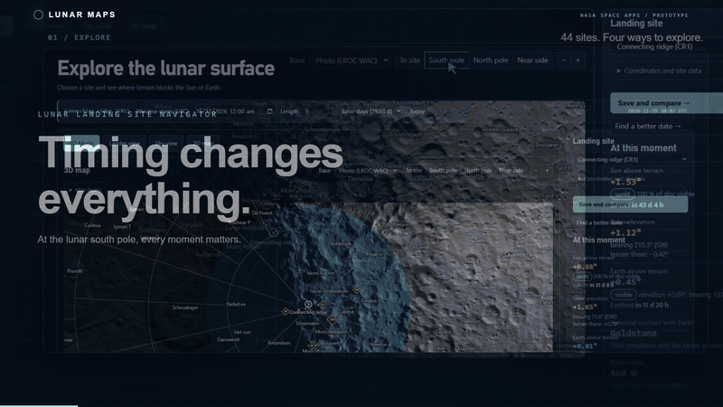

# Lunar Maps · Lunar Landing Site Navigator

**Plan for light. Stay in contact.** Lunar Maps is a NASA Space Apps Challenge prototype for comparing lunar landing sites, arrival dates, and mission assumptions. It connects a 3D view of the Moon’s south pole to a practical question: **when can a lander collect sunlight and potentially communicate directly with Earth?**

**[Launch Lunar Maps on Vercel ↗](https://lunarmaps.vercel.app/)**

[Judging and verification guide](JUDGES.md) · [Mission workspace and design notes](MISSION-WORKSPACE.md)

## Watch the 30-second demo

[](https://github.com/walizow/Lunar-Maps/blob/main/videos/lunar-maps-demo.mp4)

**[Watch or download the full video](https://github.com/walizow/Lunar-Maps/blob/main/videos/lunar-maps-demo.mp4)** · 30 seconds · Narration, music, and captions

## Why we’re building this

At the lunar south pole, the Sun and Earth can appear close to the horizon. A ridge in the wrong direction can interrupt sunlight or hide Earth. A solar-powered lander may have to draw on its battery during darkness, and a mission team may have to wait for another chance to send commands or receive data. A postponed landing can move the entire operations window relative to those events.

A planner can answer pieces of that question with tools like JPL Horizons and lunar mapping products. We built Lunar Maps to bring the terrain, sky positions, and operational trade-offs into one interactive workspace. A science team can see what changes if it keeps its priority site and moves the date. An engineering team can compare that case with a nearby site or a different mast height. Educators and visitors can see the same geometry from the lander’s perspective.

The prototype makes assumptions visible and lets users test alternatives quickly. Its outputs are estimates for exploration and early trade studies. A flight decision also needs mission-specific hardware and operational constraints.

## Try it

From the repository root, use Python 3:

```sh
python -m http.server 8000 --directory web
```

Open [the local homepage](http://localhost:8000/). Serve the files over HTTP so the browser can load the bundled JSON, images, and terrain. Use a recent browser with WebGL2 for **3D Moon** and **Lander view**. **2D map** and **Sky view** provide fallbacks on devices without WebGL2.

| Demo | What to do | What to look for |
| --- | --- | --- |
| **Explore the horizon** · [Open Earthset](http://localhost:8000/navigator.html?demo=earthset) | The demo opens at Connecting Ridge. Toggle **10 min before** and **10 min after** in **Horizon clearance**. | Earth changes from visible to hidden as its center passes behind the modeled skyline. The time and clearance readout follow the lander view. |
| **Compare scenarios** · [Open site comparison](http://localhost:8000/navigator.html?view=compare) · [Open the mast-height example](http://localhost:8000/navigator.html?demo=clearance) | Start with Connecting Ridge and Malapert Peak. In the mast example, use **Try a mission change** and **Compare outcomes** to save the 2 m and 10 m cases. | At 17 November 2026, 02:30 UTC, modeled Earth-center clearance at Connecting Ridge changes from −0.819° to +0.817°. The comparison aligns cases by elapsed mission time. |
| **Find an arrival window** · [Open date search](http://localhost:8000/navigator.html?view=find) | Set **Window starts (UTC)** to 15 November 2026, 00:00 UTC at Connecting Ridge. Keep the length at one lunar day. Search the next 90 days for the most simultaneous sunlight and potential contact. | The best sampled start is 15 December 2026, 18:00 UTC. The overlap score rises from 40.9% to 49.6% on the search grid. The detailed shortlist also flags 35 h 30 min with an empty battery under the default assumptions. |

**What to take from the results.** In the mast example, two configurations at the same place and time give different line-of-sight outcomes. In the date example, optimizing the overlap score still leaves a battery trade-off. Set **Max empty-battery hours** to zero to flag those dates and use **Compare original and best date** to inspect both mission windows. The detailed comparison samples the window differently from the search, so its percentages can differ slightly.

### Features in the workspace

- **Explore** opens on the 3D Moon. Choose from 44 presets or enter custom lunar coordinates, switch to Lander, Sky, or 2D views, then scrub time or jump to a rise or set event.
- **Compare** holds up to four scenarios with aligned timelines. Change a landing site, start date, window length, mast height, or power assumptions and compare sunlight, Earth visibility, potential contact, and battery behavior.
- **Find a window** ranks sampled dates by criteria such as most sunlight, most potential contact, or most time with both. The shortlist reports battery capacity constraints alongside the ranking.
- **Guide and Expert** present the same model with different amounts of detail. Scenario links and CSV exports help users share inputs and inspect time-series results. **NASA data & methods** describes the sources in the app.

## How NASA data supports the solution

| NASA resource | Where it appears in the repo | What it does |
| --- | --- | --- |
| [LRO Lunar Orbiter Laser Altimeter (LOLA) polar illumination and elevation products](https://pgda.gsfc.nasa.gov/products/69) | [Preset catalog and skyline masks](web/data/sites.json), [terrain processing](pipeline/build_terrain.py), [preset processing](pipeline/build_sites.py) | Terrain heights determine the local skyline at each bearing. The model compares the Sun and Earth directions with that skyline to estimate terrain blockage. |
| [NASA/JPL Horizons observer ephemerides](https://ssd-api.jpl.nasa.gov/doc/horizons.html) | [Packed ephemerides](web/data/eph/), [Connecting Ridge table](web/data/eph/derosa2012-cr1-connecting-ridge.json), [table decoding and interpolation](web/js/engine.js) | Hourly azimuth and elevation supply the moving Sun and Earth directions for preset sites during the supported 2026–2028 range. |
| [LRO Lunar Reconnaissance Orbiter Camera (LROC) mosaics](https://data.lroc.im-ldi.com/lroc/rdr_product_select) | [Bundled map layers](web/data/map/), [map processing](pipeline/build_map.py), [homepage Moon image](web/data/landing-moon.jpg) | Context for choosing a site, locating craters and ridges, and interpreting the 2D and 3D views. The homepage Moon is a capture from the app’s renderer. |

Supporting map layers use lunar feature names from the [IAU Gazetteer](https://planetarynames.wr.usgs.gov/Page/MOON/target), human-made feature locations from [LROC](https://data.lroc.im-ldi.com/lroc/view_rdr/SHAPEFILE_ANTHROPOGENIC_OBJECTS), and 2024 Artemis III candidate regions from [LROC QuickMap](https://quickmap.lroc.asu.edu/).

The core demo loads processed NASA-derived data from the same host as the app. A judge, visitor, or deployment needs only the checked-in files to run it. The raw source rasters and Horizons CSVs are separate inputs for rebuilding or independently checking the dataset.

## Model and limits

1. **Build the skyline.** Preset sites have 720 bearings per skyline and ten precomputed mast heights between 2 and 30 m. The pipeline uses finer polar LOLA terrain and a coarser global grid elsewhere. The engine interpolates between mast heights. Custom sites trace a skyline in the browser on coarser terrain (400 m polar or 7.6 km global).
2. **Place the Sun and Earth.** The engine interpolates between hourly Horizons directions in vector space to handle azimuth crossing north. Custom coordinates and times outside the bundled range use the analytical ephemeris in [astro.js](web/js/astro.js).
3. **Estimate visibility and potential contact.** The Sun can count as visible when part of its disk clears the local skyline. The Earth visibility setting defaults to the center of the disk. Potential Deep Space Network contact also requires the Moon to be above the configured elevation at one of Goldstone, Madrid, or Canberra (10° default). The estimate does not include station scheduling, antenna performance, frequency, link budget, or a specific Earth ground terminal’s actual availability.
4. **Estimate power and endurance.** Solar flux at the current Moon–Sun distance is combined with modeled exposure, panel area, efficiency, and incidence angle. Battery charge responds to generation and the configured load. Preset lander layouts are approximations. Thermal survival, battery aging, mutual panel shading, and operational procedures are outside the model.
5. **Compare and search.** Comparison aligns scenarios by time since arrival. Date search evaluates candidate starts on a 6-, 12-, or 24-hour grid depending on range, using 30-minute samples for ranking. The detailed mission series has its own sampling interval. Results near the skyline or a battery threshold are sensitive to model assumptions and sampling.

## Mission Copilot

The guided actions, comparison brief, and bundled OpenAI-generated Earthset narration work with the static app. Typed questions are available with the optional local server and a server-side OpenAI key. The assistant gets current mission context for explanation. The browser engine supplies the calculations.

From the repository root, with Node.js 24 and an optional ignored `.env`:

```sh
node --env-file-if-exists=.env scripts/serve-local.js
```

Open [the local Copilot preview](http://127.0.0.1:8766/navigator.html?demo=earthset). The server listens on loopback and accepts `OPENAI_API_KEY` (or the existing `OpenAI_API` alias). `OPENAI_MODEL` optionally overrides the server default. On a static deployment, visitors can use the guided experience. Public typed questions would require a hosted backend with its own server-side key and usage controls.

## Verification

Run the three reproducible engine checks against the shipped data with Node.js 24:

```sh
node tests/check_demo.js
```

This exercises Earthset, the mast clearance reversal, a site comparison, and the arrival-date trade-off. It needs no extra datasets. The [judging guide](JUDGES.md) includes exact browser steps, expected outcomes, and fallbacks when a browser or GPU is unavailable. The browser workflows were also exercised locally on desktop, with the homepage, date search, and comparison checked at a phone viewport.

### Independent comparison against JPL Horizons

The broader [engine validation suite](tests/check_engine.js) uses separately retrieved Sun and Earth CSV pairs for all preset sites. It checks ephemeris and packed-table decoding and also exercises Apollo 11, region, illumination, and custom-site behavior. The original raw CSV set is separate from the repo. Full CSV validation was not completed during the homepage review because only two complete pairs were available locally.

To request fresh inputs in PowerShell:

```powershell
$env:LUNAR_HORIZONS = '..\lunar-horizons-validation'
node pipeline/fetch_validation_horizons.js $env:LUNAR_HORIZONS
node tests/check_engine.js
```

The downloader queries JPL sequentially using the observer coordinates and time grid for each bundled table, records request metadata and hashes, and reuses verified files. Pass a site ID after the destination to fetch only that pair. Fresh results may differ from the original retrieval. This does not replace the bundles used by the app.

## Repository map

| Path | Purpose |
| --- | --- |
| [web/index.html](web/index.html) · [web/navigator.html](web/navigator.html) | Project homepage and mission workspace. The top-level `index.html` forwards to `web/` for root hosting. |
| [web/js/engine.js](web/js/engine.js) · [web/js/astro.js](web/js/astro.js) · [web/js/terrain.js](web/js/terrain.js) | Mission estimates, analytical ephemeris, and terrain/skyline math. |
| [web/js/app.js](web/js/app.js) · [web/js/workspace.js](web/js/workspace.js) | Shared mission state, date search, comparisons, inspection, and workspace screens. |
| [web/js/globe.js](web/js/globe.js) · [web/js/pov.js](web/js/pov.js) · [web/js/map.js](web/js/map.js) | 3D Moon, first-person lander view, and 2D map. |
| [web/data/](web/data/) · [pipeline/](pipeline/) | Runtime bundles and the scripts that prepare them. |
| [tests/](tests/) · [reference/](reference/) | Verification and historical reference data/scripts. |

### Static hosting

Publish `web/` as the static output directory on Vercel or any static host. No build step is needed. For GitHub Pages served from a branch root, the root redirect forwards to `web/`; select the intended branch and `/ (root)` in GitHub Pages settings. These are deployment instructions. The local preview above is available directly from the checkout.

### Rebuild the data

Rebuilding is optional. Install Python dependencies with `python -m pip install numpy pillow scipy`. Place the source rasters listed in [pipeline/common.py](pipeline/common.py), [pipeline/build_map.py](pipeline/build_map.py), and [pipeline/build_sites.py](pipeline/build_sites.py) under the directory named by `LUNAR_RAW`. Place the Horizons inputs in the subdirectories expected under `LUNAR_HORIZONS`. Use absolute paths when possible.

```sh
python pipeline/check_dem.py
python pipeline/build_sites.py
python pipeline/build_terrain.py
python pipeline/build_map.py
python pipeline/build_globe.py
python pipeline/build_pov.py
```

The commands regenerate checked-in data under `web/data/`. Use the shipped bundles for the published demo and review changes before replacing them.
